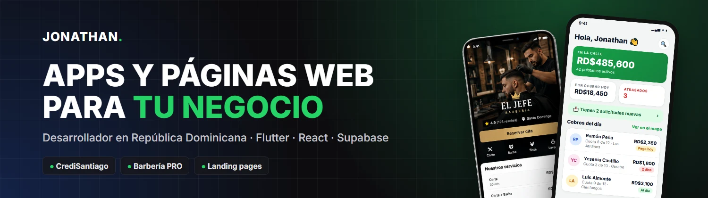
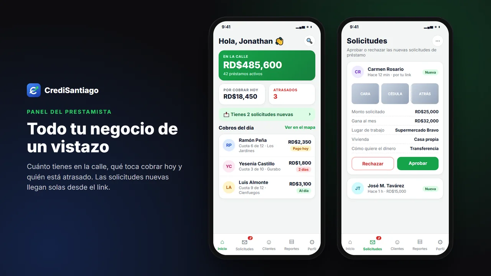
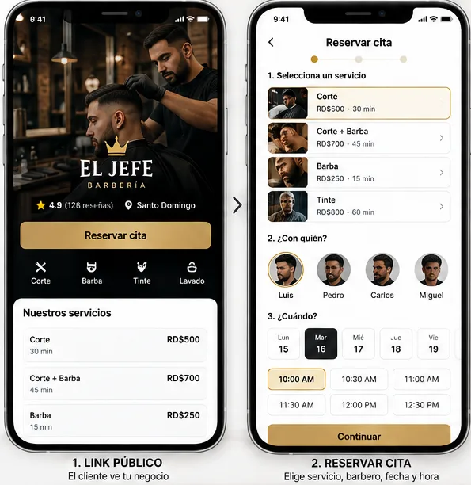

# ¡Hola, soy Jonathan Santiago! 👋

Desarrollador en **República Dominicana**. Creo apps y sistemas a la medida para negocios reales: prestamistas, barberías y emprendedores que quieren dejar el cuaderno, organizarse desde el celular y atender mejor a sus clientes.

- 🔭 Ahora mismo: terminando **Barbería PRO** y mejorando **CrediSantiago**
- 🛠️ Mi stack principal: **Flutter + Supabase** para apps, **Astro / React + Tailwind** para web
- 💬 Pregúntame sobre: apps para negocios, cobros por WhatsApp, landing pages
- ⚡ Dato: aprendí construyendo cosas que la gente usa de verdad

---

## 🚀 Proyectos destacados

### 💰 CrediSantiago · [credisantiago.netlify.app](https://credisantiago.netlify.app)

App para prestamistas, **ya publicada**, con plan gratis y planes de pago:

- Los clientes piden préstamos por un **link** que se comparte por WhatsApp, con fotos de la cédula y GPS.
- Las solicitudes llegan **en tiempo real** para aprobarlas o rechazarlas.
- **Interés sobre saldo** con tabla de amortización, **mora automática**, recibos en PDF y contratos.
- **Cobradores** con su propia ruta en el mapa, cuadre de **caja del día** y cobros **sin conexión a internet**.
- Reportes de ganancia y gráficas, exportables a Excel.

`Flutter` `Dart` `Supabase` `PostgreSQL` `Android` `Web`

### ✂️ Barbería PRO · *en desarrollo*

Agenda para barberías y salones: **reserva pública** con apartado, agenda del barbero con *Llegó / No vino*, clientes frecuentes y panel del dueño con las ventas del día. Cada negocio ve solo sus datos.

`Flutter` `React` `Supabase` `PostgreSQL` `GitHub Actions`

> El código de estos proyectos es privado. Si quieres ver una demo, escríbeme.

---

## 💻 Tecnologías

---

## 🛣️ Mi recorrido

| Año | |
|---|---|
| **2024** | Empiezo con HTML, CSS y JavaScript. Proyecto final de Python en equipo: un [gestor de tareas](https://github.com/Jsantiago28/FINAL_PYTHON-1-) con filtros y guardado en JSON. |
| **2026** | Publico **CrediSantiago**, una app completa con usuarios, planes de pago y cobradores, y empiezo **Barbería PRO**. |

---

## 📫 Hablemos

¿Tienes un negocio y quieres organizarlo o tener tu página web?

